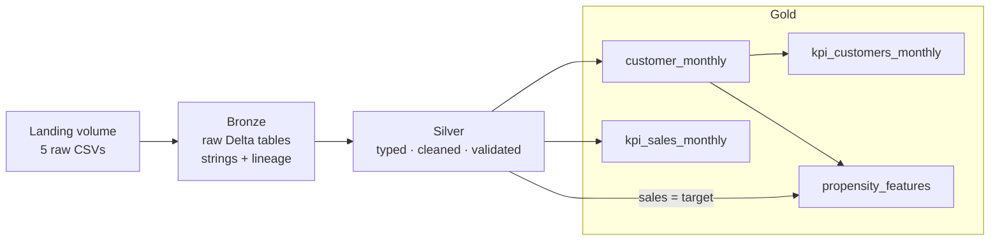

# easyMoney · Medallion data pipeline on Databricks

A production-style rebuild of the easyMoney data preparation. Five raw CSVs (~950 MB, 6M customer-month rows) flow through bronze, silver and gold Delta tables on Databricks, with data quality checks at every layer, unit-tested transformation logic and a job defined as code. The gold layer serves the monthly KPIs and the feature table for the `pension_plan` propensity model.

**Stack:** Databricks (serverless) · PySpark · Delta Lake · Unity Catalog · pytest · Databricks Jobs · Databricks Asset Bundles

## Architecture



| Layer | Tables | What happens |
|---|---|---|
| Bronze | 5 raw tables | CSV → Delta, every column as string; lineage columns `_source_file` and `_ingested_at`; source vs table row count |
| Silver | 5 typed tables | Types, normalised names, parsed dates and segments; grain, domain, parsing and referential checks; row counts reconciled with bronze (silver cleans, it never filters) |
| Gold | `customer_monthly` (5,962,924 rows) · `kpi_customers_monthly` · `kpi_sales_monthly` · `propensity_features` (5,179,225 rows) | Single customer view per month, dashboard KPIs, model features with leakage guards |

Every table stores its grain and cleaning decisions as a Unity Catalog comment.

## Finding: half of the "new contracts" were not sales

The obvious propensity target is the 0→1 transition of the `pension_plan` holding flag. Reconciling it against the sales table:

| 0→1 transition | Cases | With an actual sale |
|---|---|---|
| First-time activation | 18,451 | 100% |
| Reactivation (held the product before) | 18,318 | 0% |

Reactivations are the flag flickering from one month to the next (penetration drops from 3.6% to 2.9% in January 2019 and recovers in February), not sales. A model trained on the flag would mostly learn to predict that flicker. The gold target is therefore the **actual `pension_plan` sale in t+1**, on customers who never held the product: 18,451 positives, a 0.36% rate. The comparison stays in the pipeline as a cross-source consistency check; the diagnosis is in `00_exploration`.

Why this product: pension plans are 8% of sales but 79% of net margin (~6,000 per sale vs ~70 for an account).

## Data quality

- **Blocking checks** raise `DataQualityError` and stop the job: grain uniqueness, mandatory columns, value domains, binary flags, parse loss, referential integrity, row count reconciliation between layers and leakage guards on the target.
- **Informative checks** (null rates, ranges, distributions) live in `00_exploration`.
- **13 unit tests** cover the checks and the transformations. `test_add_customer_timeline` pins the two rules that protect the target: a gap between snapshots invalidates the next and previous month, and the purchase history never includes the current month.

## Orchestration

```
run_tests ──► bronze ──► silver ──► gold
```

Failing tests stop the job before any data is touched, and a failed layer stops everything downstream. The job is versioned as a Databricks Asset Bundle: [`databricks.yml`](databricks.yml) and [`resources/easymoney_pipeline.job.yml`](resources/easymoney_pipeline.job.yml).

## Design decisions

- **Bronze keeps everything as string.** Type problems surface in silver, explicitly, instead of becoming silent NULLs at read time.
- **`try_*` parsers + `check_no_parse_loss`.** Nothing breaks on a malformed value, and nothing gets lost without being reported.
- **Salary (~26% missing) is not imputed in gold.** Imputation belongs to model training, fitted on training months only, so no future information leaks into the past.
- **January 2018 is the first snapshot.** Previous holders cannot be excluded that month, which inflates its positive rate (0.85% vs 0.23–0.64% afterwards); flagged for the modelling step.
- **`em_acount` is normalised to `em_account`** in this pipeline; the rest of the project keeps the source spelling.
- **Full reloads (`overwrite`)** fit a static dataset. With monthly deliveries, the next step would be incremental ingestion with Auto Loader.

## Repository layout

```
data-pipeline/
├── 00_exploration.ipynb         Profiling and one-off diagnostics (not in the job)
├── 01_bronze_ingestion.ipynb    CSV → bronze Delta tables
├── 02_silver.ipynb              Typing, cleaning, validation
├── 03_gold.ipynb                customer_monthly, KPIs, propensity_features
├── run_tests.ipynb              Runs pytest inside Databricks
├── easymoney_pipeline/
│   ├── quality.py               Reusable data quality checks
│   └── transforms.py            Transformation logic shared by the notebooks
├── tests/                       Unit tests (pytest)
├── resources/
│   └── easymoney_pipeline.job.yml
└── databricks.yml               Asset Bundle definition
```

## How to run

1. Clone the repository into a Databricks Git folder.
2. Run the schema cell of `01_bronze_ingestion` (it creates the schemas and the landing volume), then upload the five CSVs to `workspace.easymoney_bronze.landing`.
3. Run the job, either from the Jobs UI or with the Databricks CLI:

```bash
databricks bundle deploy -t dev --var alert_email=you@example.com
databricks bundle run easymoney_pipeline -t dev
```

`run_tests` can also be run on its own at any time.
