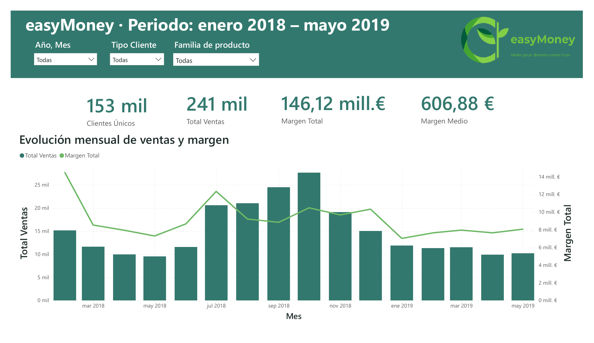
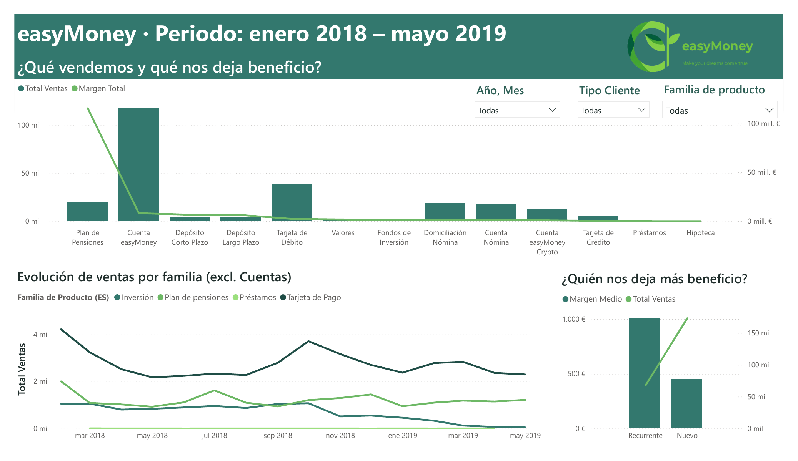
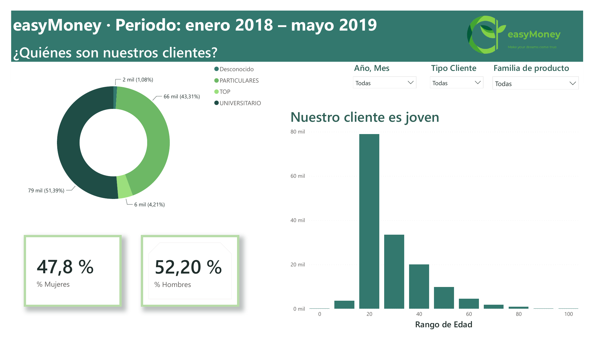
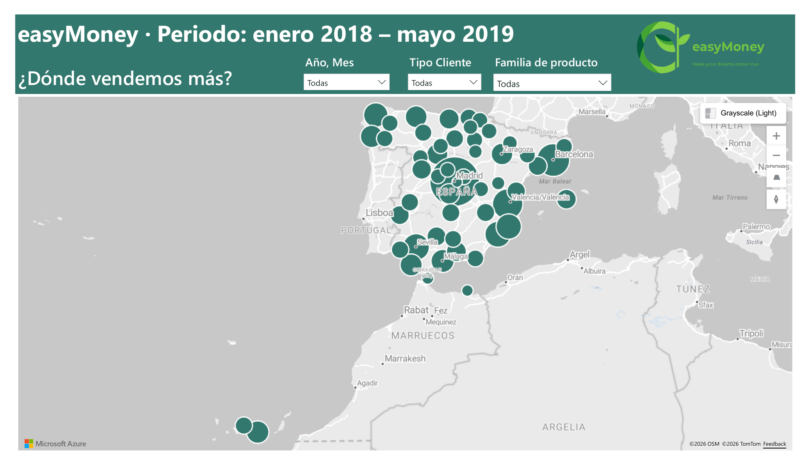
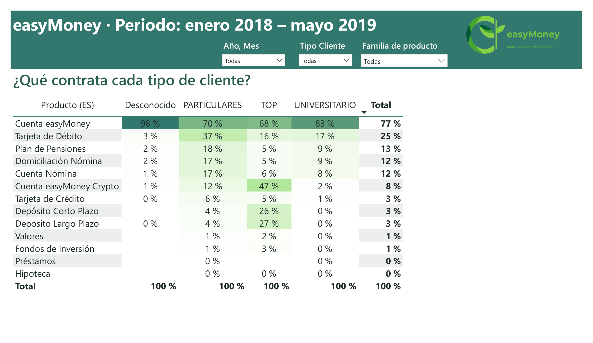

# easyMoney — Sales & Customer Dashboard (Power BI)

Five-page Power BI dashboard for **easyMoney**, a fictional fintech, covering **17 months of sales and customer data (January 2018 – May 2019)**. It answers the first question management asked in our Master's final project: *what have we sold, to whom, where, and where does the margin come from?*

This is my version of **Task 1** of the team project. The full project (propensity models, segmentation and campaign simulator) is in [`../tfm-easymoney`](../tfm-easymoney/).

📄 **[View the full dashboard (PDF)](./easymoney_dashboard.pdf)**

> The dashboard itself is in Spanish, as it was built for a Spanish-speaking business audience. Each page is explained in English below, and a [glossary](#glossary) at the end translates the labels.

---

## Headline figures

| Unique customers | Total sales | Total margin | Average margin per sale |
|:---:|:---:|:---:|:---:|
| **153K** | **241K** | **€146.1M** | **€606.88** |

## Key insights

1. **Margin is extremely concentrated.** Pension plans are under 10% of sales but generate the vast majority of the margin, while the easyMoney account is by far the most sold product and contributes very little. Any cross-selling effort should be judged by margin, not by volume.
2. **Volume and margin don't move together.** Sales peak in autumn 2018 (October ≈ 27K sales), while the highest-margin months are January and July 2018. A month with more sales is not necessarily a better month.
3. **Investment products are fading.** Among non-account products, sales of investment products fall steadily to almost zero by May 2019, while pension plans stay stable.
4. **Returning customers are worth more per sale.** Recurring customers bring in roughly twice the average margin per sale of new customers, even though new customers account for more sales.
5. **The base is young.** Over half of customers are university students and the largest age band is people in their twenties, which explains why low-margin entry products dominate volume.
6. **Each customer type buys something different.** TOP customers concentrate on the crypto account and term deposits; individuals (*particulares*) lead in debit cards and pension plans — a clear starting point for targeted offers.

---

## Dashboard pages

### 1 · Overview — monthly sales and margin



KPI cards for customers, sales and margin, plus the monthly evolution of sales (bars) against total margin (line).

- Sales grow sharply from July to October 2018 and fall back to around 10–12K per month in 2019.
- Margin does **not** follow the same pattern: it is highest in January 2018 and July 2018, which points to a few high-margin products driving the result rather than overall volume.

### 2 · What do we sell, and what makes us money?



- **Sales vs margin by product:** the easyMoney account leads in sales (≈117K) but the margin line collapses after pension plans, which carry most of the margin with far fewer sales.
- **Sales trend by product family** (excluding accounts): payment cards have the highest volume; investment products decline throughout the period; pension plans hold steady.
- **Who brings us the most profit?** Recurring customers have an average margin per sale of about €1,000, roughly double that of new customers, who in turn generate more sales.

### 3 · Who are our customers?



- **Segment mix:** university students 51.4%, individuals 43.3%, TOP 4.2%, unknown 1.1%.
- **Gender:** 47.8% women, 52.2% men.
- **Age:** the distribution is heavily skewed towards customers in their twenties, with a long tail of older customers.

### 4 · Where do we sell the most?



Bubble map of sales by province. Activity is spread across the whole country, with Madrid as the clear leader followed by Barcelona, Valencia and the main Andalusian cities. The Canary Islands, Ceuta and Melilla also appear.

### 5 · What does each type of customer buy?



Product take-up by customer type, with conditional formatting to highlight the differences:

- **TOP customers:** 47% for the easyMoney Crypto account and 26–27% for short- and long-term deposits — much higher than any other type.
- **Individuals (*particulares*):** highest share for debit cards (37%) and pension plans (18%).
- **University students:** mostly the easyMoney account (83%), with low take-up of everything else.

### Interactivity

Every page shares three slicers — **year-month**, **customer type** and **product family** — so any view can be filtered to a period, a customer type or a family of products.

---

## How it was built

| Step | Tool | Details |
|---|---|---|
| Data preparation | Python (pandas) | Cleaned and joined the 5 source tables (sales, sociodemographics, commercial activity, products, product descriptions) into one sales-level table. See [`00_powerbi_limpieza.ipynb`](../tfm-easymoney/notebooks/00_powerbi_limpieza.ipynb). |
| Missing values | Python | Gender → mode; region → `0` for foreign customers; salary → median; entry channel / segment → cross-imputation using each other's mode, `Desconocido` (unknown) when both were missing. |
| Enrichment | Python | Region codes mapped to Spanish province names for the map. |
| Data model & visuals | Power BI | Measures for total sales, total margin, average margin, unique customers and gender shares; shared slicers across pages; consistent brand colours. |

**Data:** about 240K sales and 6M customer-month records (fictional data provided for the Master's project).

## Files

```
easymoney-dashboard/
├── easymoney_dashboard.pdf   Full dashboard export (5 pages)
├── images/                   One PNG per page (used in this README)
└── README.md
```

## Glossary

| Spanish (dashboard) | English |
|---|---|
| Total Ventas · Margen Total · Margen Medio · Clientes Únicos | Total sales · Total margin · Average margin · Unique customers |
| Año, Mes · Tipo Cliente · Familia de producto | Year, Month · Customer type · Product family |
| Recurrente · Nuevo | Recurring · New |
| PARTICULARES · UNIVERSITARIO · TOP · Desconocido | Individuals · University students · Top customers · Unknown |
| Plan de Pensiones · Cuenta easyMoney · Tarjeta de Débito / Crédito | Pension plan · easyMoney account · Debit / Credit card |
| Depósito Corto / Largo Plazo · Fondos de Inversión · Valores | Short- / Long-term deposit · Investment funds · Securities |
| Domiciliación Nómina · Cuenta Nómina · Préstamos · Hipoteca | Salary direct deposit · Salary account · Loans · Mortgage |
| Rango de Edad · % Mujeres · % Hombres | Age range · % Women · % Men |
| mil · mill. | thousand · million |
