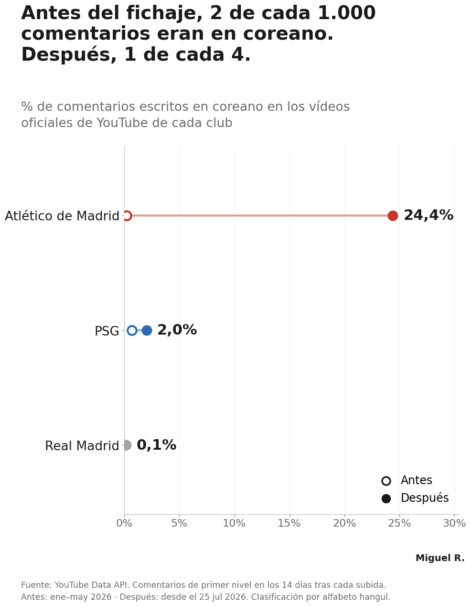
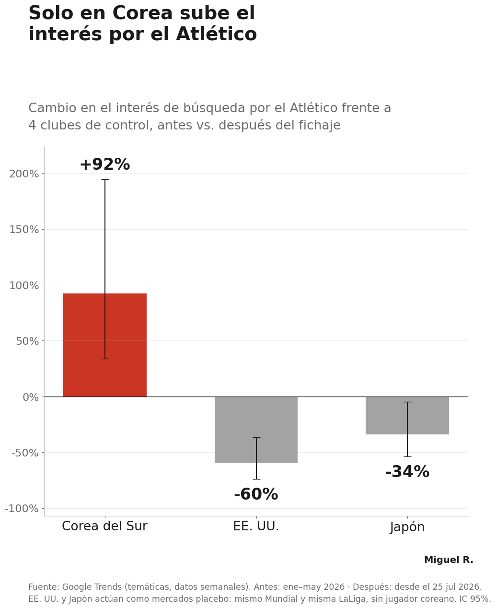
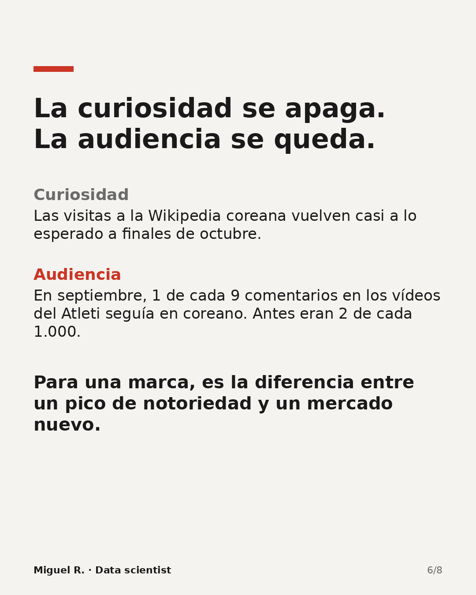
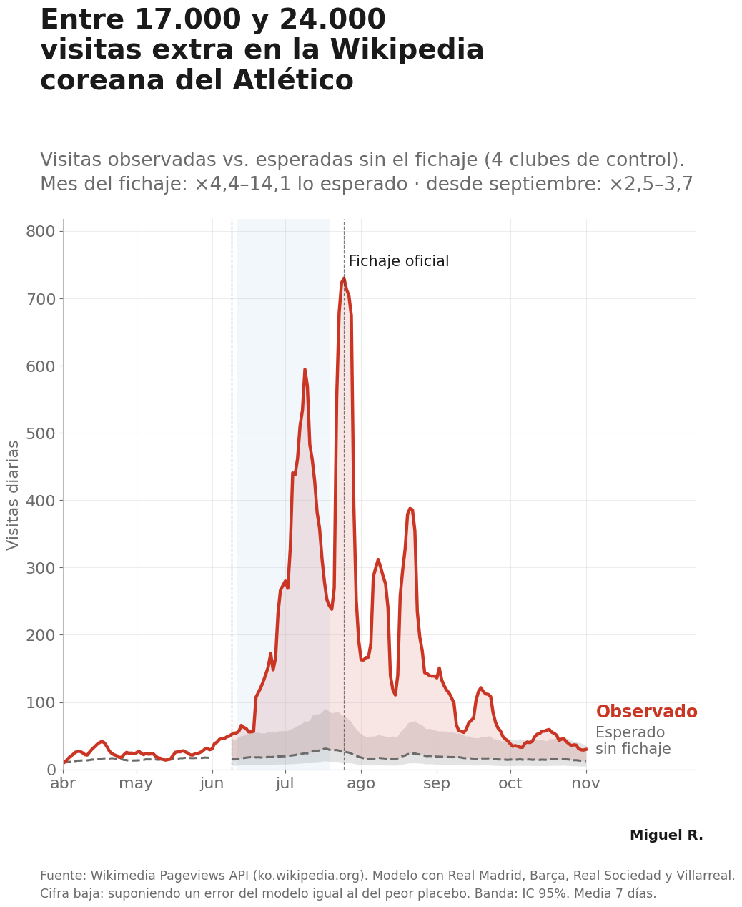

# The Kang-in Lee Effect: what did Atlético de Madrid buy in South Korea?

> **Before the signing, 21 comments in Korean in five months under Atlético's YouTube videos. After it, 2,107 in three.**

In July 2026 Atlético de Madrid signed Kang-in Lee, one of the most popular footballers in Asia. The press called it a "commercial frenzy" in Korea, but nobody published numbers. This project measures it with public data only, and treats the club as what it also is: **a company entering a new market**.

<p align="center">
  
  
</p>

---

## The business question

**How much extra attention did Atlético get from Korean-speaking audiences because of the signing, compared with what it would have had anyway?**

The hard part is *"compared with what it would have had anyway"*. The signing landed in the middle of the **2026 World Cup**, which pushed interest in football up everywhere in Korea. A before/after comparison would credit the World Cup to the player. Every result below is therefore measured **against a control**: clubs that did not sign a Korean player, or countries without a Korean player in the squad.

## Headline results

| What | Result | 95% interval |
| :---- | :---- | :---- |
| Korean-language share of comments under Atlético's YouTube videos | **0.18% → 24.4%** | 16.6% – 31.3% after |
| Difference-in-differences vs. Real Madrid | **+23.7 pp** | +16.3 to +31.1 pp |
| Same metric, only on videos where Lee does **not** appear | **0.18% → 8.6% (×46)** | 6.6% – 10.8% after |
| PSG (the club he left), videos without Lee | **0.46% → 0.18%** | — |
| Atlético search interest vs. control clubs, South Korea | **+92%** | +34% to +194% |
| Same, United States / Japan (placebo markets) | **−60% / −34%** | — |
| Extra visits to Atlético's Korean Wikipedia page since the rumours | **17,000 – 24,000** | conservative bound – model estimate |

Full table: [`results/results_summary.csv`](results/results_summary.csv).

## The finding that matters for the business: attention vs. audience



"Impact" is usually reported as one number. Here it splits into two things that behave very differently:

- **Attention** (how many people look you up) spikes with the news and fades within weeks. Visits to the Korean Wikipedia page were close to the counterfactual again by late October.
- **Audience** (who actually follows you) moves slower and stays. In September, 1 in 9 comments under Atlético's videos was still in Korean, against 2 in 1,000 before.

For a sponsor, a merchandising plan or a pre-season tour, the second one is what has value. It is the difference between a spike in awareness and a new market.

A second, less obvious result: **the audience follows the player, not the club.** Atlético gained Korean-speaking viewers even on videos without Lee, and PSG lost more than half of its Korean share on videos without him.

<br clear="right">

## Data

All sources are public and free. No paid tools, no scraping of private data.

| Source | What it measures | Volume |
| :---- | :---- | :---- |
| Wikimedia Pageviews API | Daily views of club and player pages in Korean, Japanese and English Wikipedia | 8 entities × 3 languages × 1,766 days |
| Google Trends (`pytrends`) | Weekly and daily search interest by country, using **topic entities** (language-independent) | KR, US, JP |
| YouTube Data API v3 | Top-level comments under the official channels of Atlético, PSG and Real Madrid | 3,351 videos, ~383K comments |

Raw data is not committed (YouTube's terms restrict redistributing comment data). [`data/README.md`](data/README.md) explains how to regenerate it.

## Method

**1. Counterfactual model (Korean Wikipedia).** `log(1 + views_Atlético) ~ log(1 + views_controls) + day of week`, fitted on Jan 2025 – May 2026 with Real Madrid, Barcelona, Real Sociedad and Villarreal as controls. The model predicts what Atlético would have had without the signing. Intervals come from a **moving-block bootstrap** of residuals (14-day blocks), because daily errors are autocorrelated.



**2. Placebo tests.** The same model with a fake signing one year earlier, and with each control club "treated" as if it had signed him. Atlético's effect is about 6× the largest placebo.

**3. Validation case.** The same model on his previous transfer (Mallorca → PSG, July 2023): +383% in the transfer month.

**4. Audience composition (YouTube).** A comment counts as Korean when at least 50% of its letters are Hangul (a broader "at least 2 Hangul characters" rule is reported as a sensitivity check). Only comments posted within **14 days of upload** are used, so a November comment under a January video doesn't contaminate the "before" period. Intervals use a **cluster bootstrap by video**, because comments under the same video are not independent.

**5. Country placebo (Google Trends).** Atlético's interest relative to the control clubs, before vs. after, in Korea and in two markets with the same World Cup and the same LaLiga but no Korean player.

<br clear="right">

## Where the evidence is weaker (read before quoting a number)

- **The Wikipedia model fits poorly** (pre-period R² = 0.18 on a log scale). Atlético's Korean page had only ~23 visits a day before the signing, which makes daily prediction noisy.
- **The time placebo is not zero:** with a fake 2025 signing, the model finds +67% in the equivalent month; the worst club placebo reaches +219%. That is why the visits figure is reported as a range, with a lower bound that assumes the model is as wrong as its worst placebo.
- **Comment language ≠ nationality.** Korean-language comments include the diaspora.
- **Attention, not revenue.** Shirt sales and commercial income are not public. Nothing here measures money.

The YouTube and Google Trends results are the most robust. The Wikipedia figure supports the direction and the timing, not the decimal.

## Project structure

```
kangin-lee-effect/
├── notebooks/
│   ├── 01_data_collection.ipynb   # Wikipedia, Google Trends, YouTube; QA checks and exploratory charts
│   └── 02_impact_analysis.ipynb   # counterfactual, placebos, DiD, country placebo, final charts
├── images/                        # every chart produced by the notebooks
├── results/results_summary.csv    # all headline numbers with 95% intervals
├── linkedin/linkedin_carousel.pdf # the carousel published on LinkedIn
└── data/README.md                 # how to regenerate the raw data
```

## Reproduce

1. Open the notebooks in Google Colab.
2. Add a YouTube Data API key (a standard key starting with `AIza`) as a Colab secret named `YOUTUBE_API_KEY`.
3. Run `01_data_collection.ipynb` with `USE_DRIVE = True`. The YouTube step uses about 6,400 API units (one day of free quota) and resumes automatically if interrupted.
4. Run `02_impact_analysis.ipynb`, pointing `PROJECT_DIR` to the same Drive folder.

---

*Part of a series on the business side of football: brands, markets and audiences.* [← All football business projects](../)
