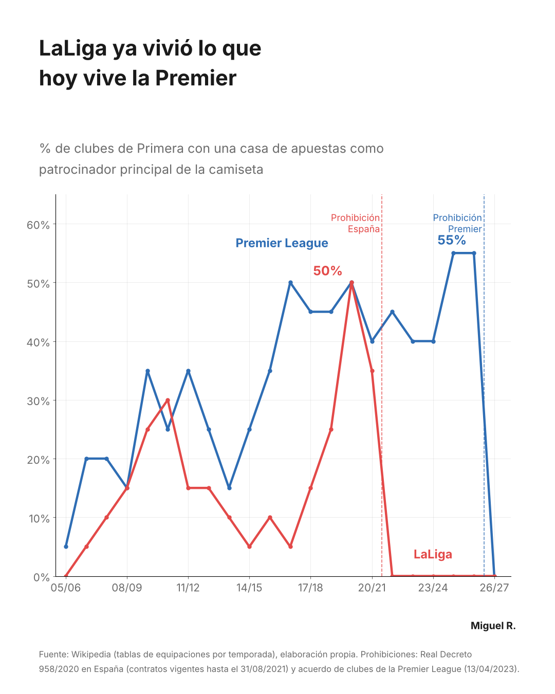
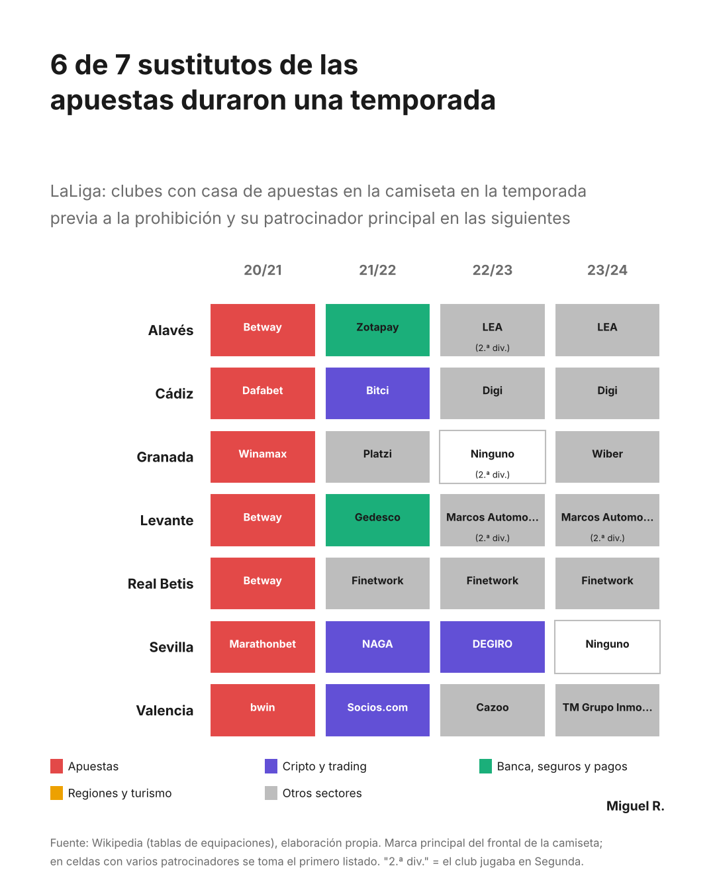
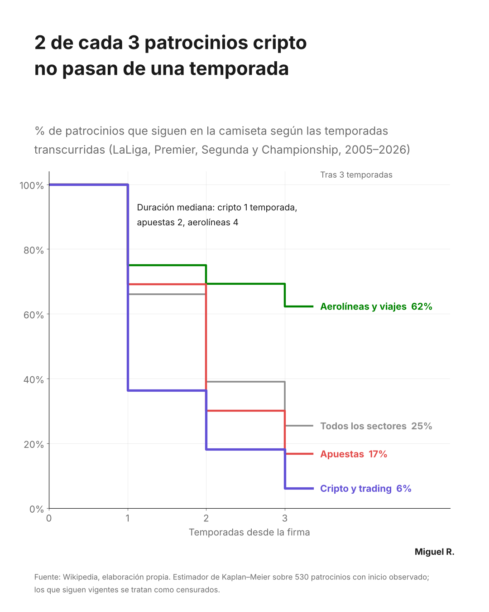

# Shirt Sponsor Churn: what happens when a whole sector is banned from the shirt?

> **In 2021 Spain banned betting brands from football shirts. Seven LaLiga clubs had to find a new main sponsor. Six of the replacements were gone after one season.**

In 2019/20 half of LaLiga's clubs wore a betting brand on the front of the shirt. One season later the law forced them all off. From 2026/27 the Premier League goes through the same thing: 11 of its 20 clubs had a betting sponsor in 2025/26.

This project treats it as a **customer churn problem**. The "customers" are sponsors, the "product" is the front of the shirt, and the question is the one any subscription business asks: **who leaves, how fast, and what predicts it?** LaLiga went through the ban five seasons earlier, so it works as a natural experiment for what the Premier League is about to see.

<p align="center">
  
  
</p>

---

## The business question

**When a sector disappears from a sponsorship market, who takes its place, and how long do they stay?**

For a club's commercial team, the price of a deal is only half of its value. A sponsor that leaves after one season forces the club to sell the shirt again next summer, usually in a hurry and with less negotiating power. Expected duration by sector is the missing number when comparing offers.

## Headline results

| What | Result |
| :---- | :---- |
| Betting share of top-flight shirts, LaLiga | **50%** (2019/20) → 35% (2020/21) → **0%** from 2021/22 |
| Betting share of top-flight shirts, Premier League | **55%** (2024/25 and 2025/26) → **0%** in 2026/27 |
| LaLiga betting replacements that lasted one season | **6 of 7** (3 crypto/trading, 2 finance/payments) |
| Crypto sponsors that left although their club stayed in LaLiga | **3 of 3** (Cádiz, Sevilla, Valencia) |
| Median sponsorship length | crypto **1** season · betting 2 · all sectors 2 · airlines **4** |
| Still on the shirt after 3 seasons | crypto **6%** · betting 17% · all sectors 25% · airlines **62%** |
| Odds of a sponsor leaving after a season, crypto vs other sectors | **×3.5** (95% CI 1.7–7.3, p = 0.001) |
| Same, airlines vs other sectors | **×0.39** (95% CI 0.17–0.90, p = 0.028) |
| Premier League replacements expected on the shirt in 2027/28 | **4.3 of 7** if they behave like their sector average |
| Same projection for LaLiga 2021/22 vs what happened | ~4.0 of 7 expected → **1** actual |

Full tables in [`results/`](results/).

## The finding that matters for the business



**The sector predicts how long a sponsor stays.** Airlines (Emirates at Arsenal since 2006, Etihad at Manchester City since 2009) are the longest relationships in the panel. Crypto and trading apps are the shortest: two in three are gone after a season.

**Replacements bought in a hurry did worse than their sector.** Three of the seven LaLiga clubs were relegated, which usually changes everything. But the three crypto sponsors left even though their clubs stayed up. Using each sector's average survival, LaLiga should have kept about four of its seven replacements; it kept one.

**The Premier League chose a different profile.** Only one replacement is a trading app (CMC Markets at Everton) and none is crypto: a tourism board, an insurer, a jobs platform, two tech companies and a commodities broker. The projection says 4.3 of 7 should still be there in 2027/28. LaLiga's case says to treat that as an upper bound.

<br clear="right">

## Data

Built from scratch from public sources, no paid tools.

| Source | What | Volume |
| :---- | :---- | :---- |
| English Wikipedia, MediaWiki API (`action=parse`) | Season pages of LaLiga, Segunda, Premier League and Championship: kits table (main shirt sponsor) and league table | 88 pages, 2005/06–2026/27 |
| Manual tagging | Canonical brand, sector and country of each sponsor | 811 sponsor names → 584 brands |

The result is a **club-season panel**: 1,782 rows, 141 clubs, 577 brands. The revision ID of every page is stored so the dataset can be rebuilt exactly. See [`data/README.md`](data/README.md).

Data quality work, because Wikipedia tables are not designed for analysis:
- **Inconsistent headers** across 22 seasons: header promotion and synonyms (*manufacturer / maker / supplier*) took the pages without a usable kits table from 20 to 5 (Segunda 2005–2009, which genuinely has none).
- **Team names** that differ between the kits table and the league table (*Betis / Real Betis*, *Deportivo / Deportivo La Coruña*, one typo in a club name): fuzzy-match QA and an alias map.
- **Cells listing several sponsors** (home/away, mid-season changes): one fixed rule, first listed / home kit.
- **Brand canonicalisation**, so *Fly Emirates → Emirates* counts as a renewal, not a change. Brand names ending in digits (*bet365*, *Plus500*) are protected from footnote stripping.

## Method

**1. Definitions fixed before looking at results.** A *change* is a different canonical brand the following season, observed in any of the four divisions. A club dropping to the third tier, or a season missing from Wikipedia, is **censored**, not counted as a change.

**2. Kaplan–Meier survival by sector.** A *spell* is a run of consecutive seasons with the same brand at the same club. Only spells with an observed start are used (530). Ongoing contracts are censored: a plain average of finished contracts would underestimate how long sponsorships last.

**3. Discrete-time hazard model.** Logistic regression on 1,150 club-seasons at risk: *P(brand changes after season t)* on sector, foreign brand, division, league, relegation and promotion at the end of the season, and spell age. Standard errors **clustered by club**.

**4. Robustness check.** The same model without the 17 betting sponsors the bans *forced* out. Without it, the ban itself inflates the betting effect: betting goes from ×1.51 (p = 0.02) to ×1.31 (p = 0.14), so **betting is not claimed as a high-churn sector**. Crypto and airlines barely move.

**5. Case follow-up and projection.** Every club with a betting sponsor in the last season before each ban, followed season by season. The Premier League projection gives each new sponsor its sector's one-season survival rate.

## Where the evidence is weaker

- **Duration, not money.** Contract values are not consistently public.
- **The ban cases are small** (7 clubs in LaLiga, 11 in the Premier League). They are cases, not a sample; the statistical results use the full panel.
- **Promotion and relegation are not significant** in the robust model (promotion ×1.58, p = 0.06; relegation ×1.33, p = 0.25).
- **Sector tags are judgement calls** for some brands: payment processors, and "sports news" brands with links to online gaming, tagged as *other* with a note. All tags and notes are in [`data/manual/sponsor_tags.csv`](data/manual/sponsor_tags.csv).
- **Wikipedia is community-edited.** Revision IDs make the extraction auditable, not error-free.

## Project structure

```
shirt-sponsor-churn/
├── notebooks/
│   ├── 01_build_dataset.ipynb      # MediaWiki API, table parsing, name cleaning, QA checks, club-season panel
│   └── 02_survival_analysis.ipynb  # sector mix, churn rates, Kaplan–Meier, hazard model, ban cases, charts
├── data/
│   ├── processed/club_seasons.csv  # the panel (output of notebook 01)
│   └── manual/sponsor_tags.csv     # brand, sector and country per sponsor (hand-labelled)
├── images/                         # charts produced by notebook 02
├── results/                        # key numbers, KM table, hazard model, ban cases
└── linkedin/linkedin_carousel.pdf  # the carousel published on LinkedIn
```

## Reproduce

1. Create a folder `proyecto_patrocinios/` next to the notebooks (or open them in Google Colab, which uses `MyDrive/proyecto_patrocinios`).
2. Run `01_build_dataset.ipynb`. It downloads the 88 pages (cached, with retries and rate-limit handling) and writes `data/processed/club_seasons.csv` and `data/manual/sponsors_to_tag.csv`.
3. Tag the sponsors, or copy [`data/manual/sponsor_tags.csv`](data/manual/sponsor_tags.csv) into `proyecto_patrocinios/data/manual/`.
4. Run `02_survival_analysis.ipynb` (needs `lifelines` and `statsmodels`).

---

*Part of a series on the business side of football: brands, markets and audiences.* [← All football business projects](../)
