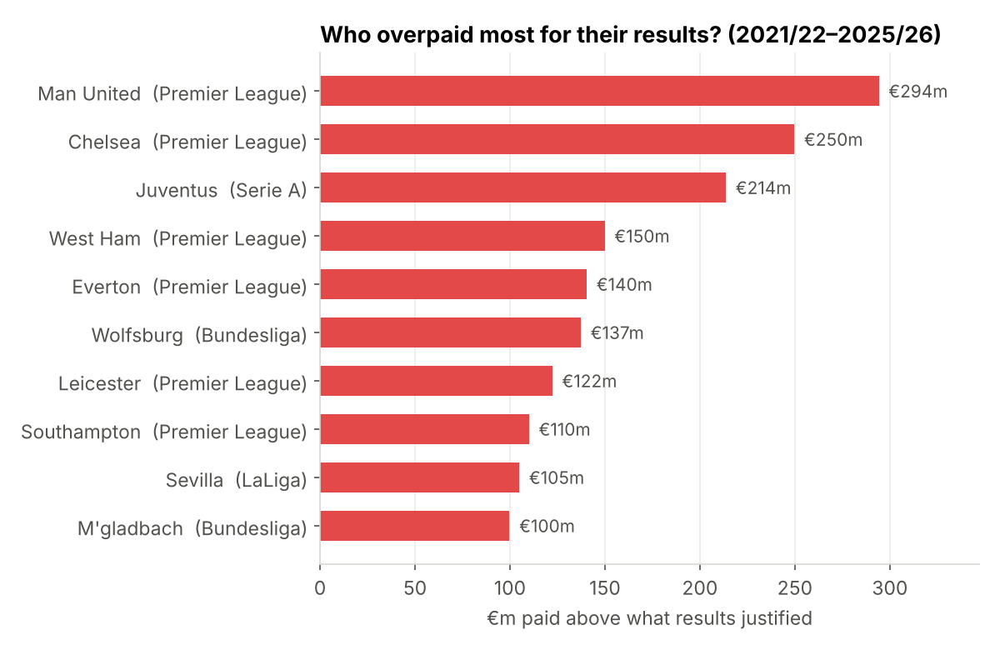
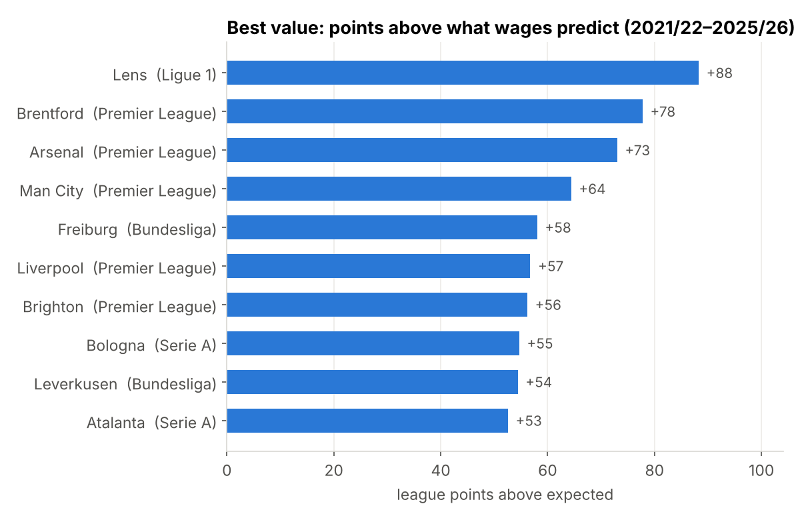
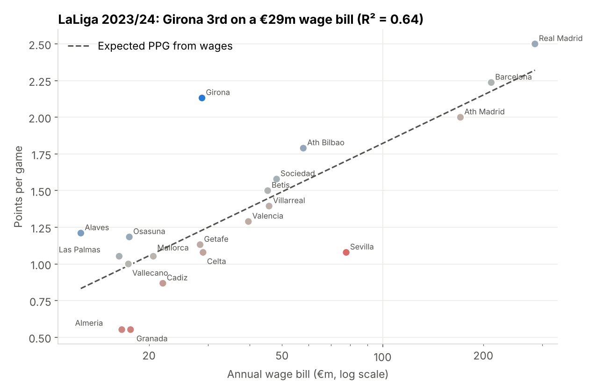

# Wage Efficiency: who overpays for results in European football?

> **Over five seasons Manchester United paid €294m more in wages than their results justified. Lens finished 88 points above what their wage bill predicted, on a fraction of the money.**

Wages are the biggest cost line of any football club and the best single predictor of where it finishes. That makes them the right place to ask a sporting director's question: **given what a club pays its squad, how many points should it get, and how much money is it wasting?**

The project builds a club-season panel for Europe's Big 5 leagues (2021/22–2025/26, **484 club-seasons**), fits an expected-points model from wages and ranks every club by how far it lands above or below that line, in points and in euros.

**[→ Live interactive app](https://football-wage-efficiency.streamlit.app/)** ([source](./app/)) · ranking, wages-vs-points chart per league and season, and a profile for every club.

<p align="center">
  
  
</p>

---

## The business question

A wage bill is an investment in points. Like any marketing or sales budget, the useful number is not how much was spent but **what each euro returned compared with a benchmark**. Here the benchmark is the rest of the league: what does a given wage bill usually buy?

The same logic applies outside football: cost per acquisition in marketing, branch productivity in banking, store performance against footprint in retail.

## Headline results

| What | Result |
| :---- | :---- |
| Share of the table explained by wages (mean R²) | **58%** · LaLiga 69% · Serie A 67% · Bundesliga 54% · Ligue 1 52% · Premier League **46%** |
| Biggest overspend, 5 seasons | **Man United +€294m** (−56 pts vs expected) · Chelsea +€250m · Juventus +€214m |
| Best value, 5 seasons | **Lens +88 pts** on €112m of total wages · Brentford +78 · Freiburg +58 · Bologna +55 · Atalanta +53 |
| LaLiga | Sevilla −60 pts and +€105m overpaid · Rayo Vallecano +41 pts on €94m, the lowest five-season wage bill in LaLiga |
| Best single seasons | Lens 2022/23 (2nd on €11m, +38 pts) · Leverkusen 2023/24 (+36) · Girona 2023/24 (3rd on €29m, +34) |
| Worst single seasons | Man United 2021/22 (+€178m overpaid) · Chelsea 2022/23 (12th on €221m, +€167m) |
| Is the ranking driven by bad wage data? | No: Spearman correlation between over-performance and the share of estimated wages = **0.01** |

Full tables in [`results/`](results/).

<p align="center">
  
</p>

## Method

1. **Data collection** ([`01_data_collection.ipynb`](notebooks/01_data_collection.ipynb))
   - League tables rebuilt from match results (football-data.co.uk): points, points per game, goal difference, position. Point deductions are ignored on purpose, since the goal is sporting output.
   - Squad wage bills from Capology via FBref, including the share of each bill that is estimated.
   - Squad market value at season start from Transfermarkt (dcaribou dataset), used as an alternative spend measure.
   - Entity matching across three naming conventions ("Ath Madrid", "Atlético Madrid", "Atlético de Madrid"): fuzzy suggestions, a duplicate check, and a reviewed mapping table with documented manual fixes.
2. **Model** ([`02_model_ranking.ipynb`](notebooks/02_model_ranking.ipynb))
   - One regression per league and season: `PPG = a + b · log(wage bill)`. Per league-season so that Premier League money and wage inflation never get compared in nominal euros; log because each extra million buys fewer points at the top.
   - **Points vs expected** = (actual − expected PPG) × games played.
   - **Overpaid €** = wage bill − the wage bill the model needs for the points actually won.
   - Quadrants: wage bill above/below the league median × performance above/below expected.
3. **Robustness**: the ranking is re-run with squad market value instead of wages, and with goal difference per game or final position instead of PPG. Goal difference gives an almost identical ranking; the other two keep most of the top 10.

## Limitations

- **Wages are estimates** for most clubs outside the elite (Capology). The data-quality check above shows this does not bias the ranking, but individual figures should be read as approximations.
- **League games only**: European and cup workload is not modelled, which slightly penalises clubs with heavy European schedules.
- **Wages ≠ total squad cost**: transfer amortisation is not included.
- **Overpaid € is asymmetric**: overpayment is capped by a club's own wage bill, while the "saving" of a title winner grows exponentially. That is why over-performance is reported in points.
- **Association, not causation**: a large residual can reflect good management, luck or an underpriced squad.
- The English Championship was planned but dropped: FBref publishes no wage data for it.

## Repository structure

```
wage-efficiency/
├── app/              # Streamlit app (app.py, data, requirements)
├── data/             # club_season_panel.csv — 484 club-seasons
├── images/           # charts used in this README
├── notebooks/        # 01 data collection · 02 model & ranking
└── results/          # rankings, per-season efficiency, model fits, summary
```

The notebooks run in Google Colab with data stored in Google Drive (paths at the top of each notebook).

## Run the app

Live: **https://football-wage-efficiency.streamlit.app/**

Locally:

```bash
cd app
pip install -r requirements.txt
streamlit run app.py
```

[← Back to Football Business](../)
